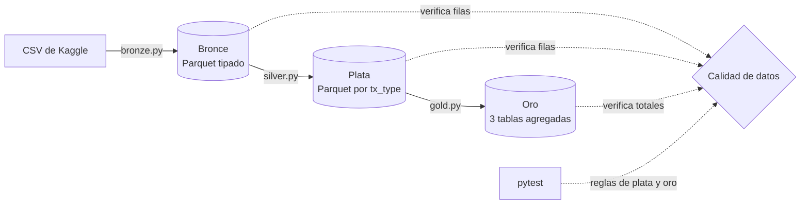

# payments-pyspark-parquet
PySpark pipeline on the PaySim synthetic mobile money dataset: CSV to Parquet in three layers (bronze, silver and gold), with data quality checks and window functions. It processes 6,362,620 transactions and answers three business questions.

> **Estado:** pipeline funcional con tests automatizados en pytest.

**English summary:** PySpark reads the PaySim CSV with an explicit schema (bronze), renames columns, derives day and hour from `step` and flags whether origin and destination balances match the amount, without dropping rows (silver, partitioned by transaction type), and builds three aggregated tables (gold): daily volume by type, fraud by type and a balance mismatch summary. Every layer checks its row totals, and a pytest suite validates the transformation rules on a small sample.

## Objetivo

Construir un pipeline por capas (bronce, plata y oro) sobre 6,4 millones de transacciones de dinero móvil, tratando los problemas de calidad que trae el dataset (saldos que no cuadran, importes en cero), y dejar tablas listas para responder preguntas de negocio como:

- ¿Cuántas transacciones y qué monto hay por tipo y por día?
- ¿Qué tipos concentran el fraude y cuál es su tasa?
- ¿Cuántas operaciones tienen saldos que no cuadran, y en qué tipos?

## Arquitectura



| Capa | Qué hace | Salida |
|---|---|---|
| **Bronce** | Lee el CSV con esquema explícito y modo `FAILFAST`, valida el encabezado y comprueba el total de filas (6.362.620) | Parquet |
| **Plata** | Renombra columnas a snake_case, convierte los indicadores de fraude a booleano, deriva `tx_day`, `tx_hour` y `dest_is_merchant`, y marca si los saldos de origen y destino cuadran con el importe, con la causa del descuadre. No elimina filas | Parquet particionado por `tx_type` |
| **Oro** | Volumen diario por tipo, fraude por tipo y resumen de descuadres. Al final verifica los totales de transacciones, fraude y descuadres | Parquet, un archivo por tabla |

Las tres etapas se pueden repetir sin duplicar datos (`overwrite`).

## Stack

- **Python** y **PySpark 4.2.0** para las transformaciones
- **Parquet** como formato de almacenamiento de las tres capas
- **pytest** para las pruebas de las reglas de plata y oro
- **Ubuntu (Linux)** y **Java 17** (OpenJDK) como entorno de desarrollo
- **Git / GitHub** para control de versiones

## Dataset

Lopez-Rojas, E. A., Elmir, A., & Axelsson, S. (2016). PaySim: A financial mobile money simulator for fraud detection. In: The 28th European Modeling and Simulation Symposium (EMSS), Larnaca, Cyprus. Dataset: Synthetic Financial Datasets For Fraud Detection, Kaggle. https://www.kaggle.com/datasets/ealaxi/paysim1

Licencia del dataset: [CC BY-SA 4.0](https://creativecommons.org/licenses/by-sa/4.0/). Es un dataset sintético de transacciones de dinero móvil: 6.362.620 filas con cinco tipos de transacción.

Los datos **no se incluyen en este repositorio**. Se descargan desde Kaggle. Se transforman en las capas bronce, plata y oro de este proyecto (tipado, renombrado de columnas, columnas derivadas, indicadores de calidad y agregaciones).

Los resultados derivados del dataset (tablas de este README y de la capa oro) se comparten bajo la misma licencia, CC BY-SA 4.0. El código de este repositorio se distribuye bajo licencia MIT (ver `LICENSE`).

## Estructura del repositorio

```
.
├── data/                  # capas bronce, plata y oro (no versionado)
├── src/
│   ├── bronze.py          # CSV -> Parquet con esquema explícito
│   ├── silver.py          # renombrado, campos derivados y banderas de calidad
│   └── gold.py            # tablas agregadas y comprobaciones finales
├── tests/
│   ├── conftest.py        # SparkSession y muestra de 8 filas
│   ├── test_silver.py
│   └── test_gold.py
├── pytest.ini
├── requirements.txt
└── README.md
```

## Cómo ejecutarlo

Probado en Ubuntu (Linux) con Java 17 (OpenJDK) y PySpark 4.2.0.

**1. Clonar el repositorio y crear el entorno**

```bash
git clone https://github.com/LuisEnrique98/payments-pyspark-parquet.git
cd payments-pyspark-parquet
python -m venv .venv
source .venv/bin/activate
pip install -r requirements.txt
java -version                 # PySpark necesita Java
```

**2. Descargar el dataset**

Crear la carpeta `data/raw/` (no viene en el repositorio):

```bash
mkdir -p data/raw
```

Descargar el CSV desde [Kaggle](https://www.kaggle.com/datasets/ealaxi/paysim1) y dejarlo en `data/raw/`. El nombre de archivo que espera el pipeline está en `RAW_CSV` de `src/bronze.py`.

**3. Ejecutar las capas**

Desde la raíz del proyecto:

```bash
python src/bronze.py
python src/silver.py
python src/gold.py
```

Cada script imprime `BRONCE OK`, `PLATA OK` y `ORO OK` si sus comprobaciones pasan.

**4. Correr los tests**

```bash
pytest
```

## Decisiones de diseño

- **Esquema explícito y `FAILFAST`:** bronce falla si una fila no cumple el esquema o si el encabezado cambia, en lugar de cargar datos corruptos en silencio.
- **Plata sin pérdida de filas:** conserva las 6.362.620 filas y solo agrega indicadores. Los descuadres se marcan con su causa y no se eliminan.
- **Particionado por `tx_type`:** las consultas por tipo de transacción leen solo la partición necesaria.
- **Día = 24 pasos:** `step` es un contador de horas (1 a 743), así que `tx_day` y `tx_hour` se derivan de él. Eso da 31 días y el último es parcial, por lo que `daily_volume_by_type` lo marca con `is_partial_day`.
- **Tolerancia con redondeo:** los saldos e importes son `double`, así que una diferencia real de 0,01 puede salir como 0,01000000000022 y marcarse como descuadre. Las comparaciones redondean la diferencia a 2 decimales antes de aplicar `TOLERANCE = 0.01`. Como el dataset usa 2 decimales, esto solo elimina el ruido de coma flotante y los descuadres de origen bajaron de 3.777.817 a 3.601.595.
- **Comercios:** los destinos que empiezan con `M` son comercios, aparecen solo en PAYMENT y no se evalúa su saldo.
- **Oro como funciones:** cada tabla es una función que recibe plata y devuelve un DataFrame. Agregar una tabla nueva es escribir su función y añadirla a `TABLES`. Las tablas son pequeñas, así que se escriben en un solo archivo Parquet.
- **Ejecución repetible:** `overwrite` en las tres capas permite repetir la carga sin duplicar datos.

## Calidad de datos

Cada capa comprueba su total de filas y `gold.py` comprueba además las transacciones, el fraude (8.213) y los descuadres (3.601.595). La suite de pytest (28 tests, unos 19 segundos) usa una muestra de 8 filas con un caso por regla:

- **Plata:** día y hora a partir de `step`, comercio frente a cliente, deltas de saldo, causas de descuadre y un test de regresión del ruido de coma flotante.
- **Oro:** totales diarios, día parcial, tasa de fraude y porcentajes de descuadre que suman 100 por tipo.

**Hallazgos**

| Hallazgo | Detalle |
|---|---|
| Fraude | 8.213 transacciones, solo en TRANSFER y CASH_OUT |
| Comercios | Los destinos de comercio aparecen solo en PAYMENT |
| Columna `step` | Va de 1 a 743 sin huecos, el último día tiene solo 23 horas |
| Importes en cero | 16 transacciones, todas CASH_OUT con fraude |
| Nulos | Solo los esperados: `dest_delta_matches_amount` (2.151.495, destinos de comercio) y `orig_mismatch_cause` (2.761.025, saldo que cuadra) |
| Descuadres de saldo | 3.601.595 operaciones no cuadran en origen, casi todas por saldo inicial en cero o cuenta vaciada |
| Causa `other` | Solo 54 casos sin causa conocida. En 52 el saldo de origen es igual antes y después con un importe mayor que cero, y los otros 2 son CASH_OUT del paso 8 donde el saldo final de origen es igual al importe |
| Alerta del sistema | `isFlaggedFraud` marca solo 16 de las 409.110 transferencias de más de 200.000 (las 16 son fraude) y no marca ninguna otra transacción |

**Limitaciones:** es un dataset sintético, así que los patrones (por ejemplo los descuadres) son una característica del simulador y no se pueden extrapolar a datos reales. Las causas de descuadre se infieren de los saldos y no se pudieron confirmar con quien generó el dataset. El análisis de saldos de destino excluye los comercios.

## Resultados

Los montos están en las unidades monetarias del simulador.

### 1. Transacciones y monto por tipo y por día

La tabla `daily_volume_by_type` tiene 152 filas, una por día y tipo con actividad. Totales por tipo:

| Tipo | Transacciones | % de transacciones | Monto total (miles de millones) | % del monto | Importe promedio |
|------|--------------:|-------------------:|--------------------------------:|------------:|-----------------:|
| CASH_OUT | 2.237.500 | 35,17 % | 394,4 | 34,46 % | 176.274 |
| PAYMENT | 2.151.495 | 33,81 % | 28,1 | 2,45 % | 13.058 |
| CASH_IN | 1.399.284 | 21,99 % | 236,4 | 20,65 % | 168.920 |
| TRANSFER | 532.909 | 8,38 % | 485,3 | 42,41 % | 910.647 |
| DEBIT | 41.432 | 0,65 % | 0,2 | 0,02 % | 5.484 |
| **Total** | **6.362.620** | 100 % | **1.144,4** | 100 % | |

- PAYMENT y CASH_OUT concentran dos tercios de las transacciones, pero TRANSFER mueve el 42 % del dinero con solo el 8 % de las operaciones: su importe promedio es más de cinco veces el de CASH_IN o CASH_OUT.
- La actividad está muy concentrada en el tiempo: 14 de los 31 días reúnen el 93,5 % de las transacciones (entre 349.776 y 574.255 por día) y los otros 17 tienen menos de 58.000 cada uno. Por ejemplo, el día 1 tiene 574.255 transacciones, el día 2 tiene 455.238 y el día 3 solo 1.070.

### 2. Fraude por tipo

Hay 8.213 transacciones fraudulentas (0,129 % del total) y solo aparecen en dos tipos:

| Tipo | Transacciones | Fraudes | Tasa de fraude | Monto fraudulento |
|------|--------------:|--------:|---------------:|------------------:|
| TRANSFER | 532.909 | 4.097 | 0,7688 % | 6.067.213.184,01 |
| CASH_OUT | 2.237.500 | 4.116 | 0,1840 % | 5.989.202.243,83 |
| CASH_IN | 1.399.284 | 0 | 0 % | 0 |
| PAYMENT | 2.151.495 | 0 | 0 % | 0 |
| DEBIT | 41.432 | 0 | 0 % | 0 |

- El fraude se reparte casi a partes iguales entre CASH_OUT (50,1 %) y TRANSFER (49,9 %), pero la tasa de TRANSFER es unas cuatro veces mayor porque tiene muchas menos operaciones.
- El fraude suma 12.056 millones, el 1,05 % del monto total: son pocas operaciones pero de importe alto.
- El indicador `isFlaggedFraud` del sistema detecta muy poco: marca 16 de las 409.110 transferencias de más de 200.000, y las 16 son fraude real.

### 3. Saldos que no cuadran

Una transacción "cuadra" cuando la variación del saldo de origen coincide con el importe (diferencia máxima de 0,01). Hay **3.601.595 operaciones que no cuadran en origen, el 56,61 % del total**. La causa se clasifica así:

- `zero_origin_balance`: el saldo inicial del origen es 0.
- `account_emptied`: el saldo final del origen es 0.
- `other`: cualquier otro caso.

| Tipo | Transacciones | No cuadran | % del tipo | zero_origin_balance | account_emptied | other |
|------|--------------:|-----------:|-----------:|--------------------:|----------------:|------:|
| TRANSFER | 532.909 | 507.529 | 95,24 % | 282.783 | 224.729 | 17 |
| CASH_OUT | 2.237.500 | 1.981.123 | 88,54 % | 1.025.782 | 955.337 | 4 |
| PAYMENT | 2.151.495 | 1.101.124 | 51,18 % | 774.245 | 326.879 | 0 |
| DEBIT | 41.432 | 11.786 | 28,45 % | 6.158 | 5.628 | 0 |
| CASH_IN | 1.399.284 | 33 | 0,00 % | 0 | 0 | 33 |
| **Total** | **6.362.620** | **3.601.595** | **56,61 %** | **2.088.968** | **1.512.573** | **54** |

- Los descuadres se concentran en TRANSFER y CASH_OUT (88 % a 95 % de sus operaciones). CASH_IN cuadra prácticamente siempre.
- Más del 99,99 % corresponde a saldo inicial en cero o a cuenta vaciada.
- En el destino, 640.413 operaciones no cuadran (no se evalúan los destinos que son comercios).

## Roadmap

- [x] Capa bronce: CSV a Parquet con esquema explícito
- [x] Capa plata: campos derivados y banderas de calidad
- [x] Capa oro: volumen, fraude y descuadres
- [x] Tests con pytest sobre una muestra pequeña
- [ ] Integración continua con GitHub Actions
- [ ] Comparativa de tiempos entre PySpark, pandas y DuckDB

## Autor

**Luis Enrique Allcca Alarcón** — Data Analyst | Data Engineering  
[LinkedIn](https://www.linkedin.com/in/luis-enrique-allcca-alarcon) · [GitHub](https://github.com/LuisEnrique98)

## Licencia

Código bajo licencia [MIT](LICENSE). Dataset y resultados derivados bajo [CC BY-SA 4.0](https://creativecommons.org/licenses/by-sa/4.0/).